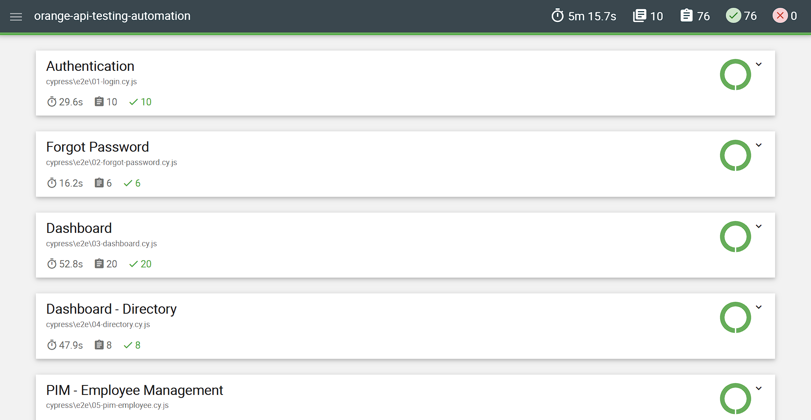
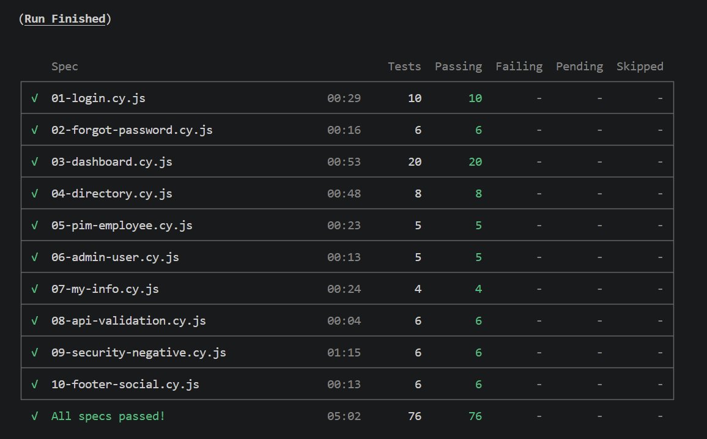
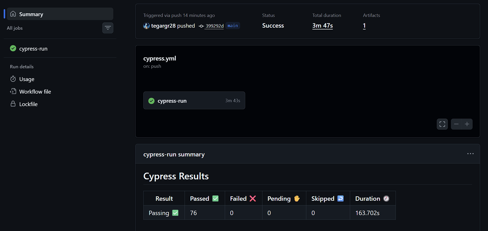

# OrangeHRM Web Automation Testing – Cypress QA Portfolio


## Project Overview

This project is a hands-on **QA automation portfolio** built with Cypress against the OrangeHRM demo application. It covers UI end-to-end flows, API validation, negative testing, and basic security checks, using the Page Object Model (POM) and reusable custom commands.

It complements my manual testing work in [orangehrm-api-testing](https://github.com/tegargr28/orangehrm-api-testing) (Postman, test plan, test cases, bug report) by automating the same application at the UI and API level.

This project was developed through self-directed learning and practical testing exercises.

## Tools & Technologies

- **Cypress** – E2E and API test automation
- **JavaScript (ES6)** – Test scripting
- **Page Object Model (POM)** – Maintainable page abstractions
- **Custom Commands & `cy.session`** – Reusable, cached login
- **Fixtures** – Externalized test data
- **cy.intercept / cy.request** – Network and API validation
- **Mochawesome (cypress-mochawesome-reporter)** – HTML test report
- **GitHub Actions** – CI pipeline
- **Git & GitHub** – Version control

## Scope of Testing

| # | Module | Spec file | Test cases |
|---|--------|-----------|-----------:|
| 1 | Authentication | `01-login.cy.js` | 10 |
| 2 | Forgot Password | `02-forgot-password.cy.js` | 6 |
| 3 | Dashboard (widgets, sidebar, logout) | `03-dashboard.cy.js` | 20 |
| 4 | Dashboard – Directory | `04-directory.cy.js` | 8 |
| 5 | PIM – Employee Management | `05-pim-employee.cy.js` | 5 |
| 6 | Admin – User Management | `06-admin-user.cy.js` | 5 |
| 7 | My Info | `07-my-info.cy.js` | 4 |
| 8 | API Validation | `08-api-validation.cy.js` | 6 |
| 9 | Negative & Security Checks | `09-security-negative.cy.js` | 6 |
| 10 | Footer & Social Media | `10-footer-social.cy.js` | 6 |
| | **Total** | | **76** |

### 1. Authentication
- Login with valid credentials, invalid username, and invalid password
- Required-field validation (empty username, empty password, both empty)
- Password masking and case sensitivity
- Form reset after refresh
- Logout

### 2. Forgot Password
- Open page and verify instructions
- Submit reset request with valid username (server response stubbed, see [Limitations](#limitations))
- Required-field validation
- Cancel redirects to login
- Field cleared after refresh

### 3. Dashboard
- Dashboard loads after login
- All 7 dashboard widgets displayed
- Sidebar navigation for 10 modules (data-driven)
- Sidebar search
- Logout from user dropdown

### 4. Dashboard – Directory
- Access Directory menu
- Search employee (by name, and non-existing name)
- Reset filter
- Validate data loaded successfully (UI + API response)
- Filter by Job Title and Location (verified through intercepted API request)

### 5. PIM – Employee Management
- Employee list loads
- Required-field validation on Add Employee
- **Full E2E flow: add → search → delete → verify deleted**
- Search not found and reset filter

### 6. Admin – User Management
- Page and table load
- Search existing / non-existing user
- Reset filter

### 7. My Info
- Personal Details, Contact Details, Emergency Contacts navigation
- Required-field validation (no data saved)

### 8. API Validation
- Unauthorized request returns `401`
- Authenticated request returns `200` with valid JSON structure
- Pagination limit respected
- Required fields in response body
- Non-existing resource returns client error (`4xx`)
- Content-type and response time assertions

### 9. Negative & Security Checks
- Protected pages redirect to login (before login and after logout)
- SQL injection string in login
- XSS payload does not execute
- Very long input
- Special characters in search

### 10. Footer & Social Media
- LinkedIn, Twitter/X, Facebook, YouTube links
- OrangeHRM footer link and copyright

## Project Structure

```
orange-api-testing-automation/
├── .github/workflows/cypress.yml     # CI pipeline
├── cypress/
│   ├── e2e/                          # Test specs (numbered for execution order)
│   │   ├── 01-login.cy.js
│   │   ├── 02-forgot-password.cy.js
│   │   ├── ...
│   │   └── 10-footer-social.cy.js
│   ├── fixtures/                     # Test data (users, employees)
│   └── support/
│       ├── pages/                    # Page Object Model classes
│       ├── commands.js               # Custom commands (login, getInputByLabel, ...)
│       └── e2e.js                    # Global config & reporter registration
├── img/                              # Screenshots used in this README
├── cypress.config.js
├── package.json
└── README.md
```

## How to Run

### Prerequisites
- Node.js (LTS)
- Google Chrome or Microsoft Edge

### Setup

```bash
git clone https://github.com/tegargr28/orange-api-testing-automation.git
cd orange-api-testing-automation
npm install
```

### Commands

| Command | Description |
|---------|-------------|
| `npm run cy:open` | Open Cypress Test Runner (interactive) |
| `npm run cy:run` | Run all specs headless (in numbered order) |
| `npm run cy:run:edge` | Run all specs in Microsoft Edge |
| `npm run test:auth` | Run only Authentication + Forgot Password |

Specs are prefixed with numbers (`01-`, `02-`, ...) so Cypress runs them in a predictable order.

## Test Report

After `npm run cy:run`, an HTML report is generated at:

```
cypress/reports/index.html
```

The report includes pass/fail charts and embedded screenshots for failed tests.

### Latest Local Run

**76 tests, 76 passing, 0 failing** (10 specs, Microsoft Edge, headless run in about 5 minutes).





## CI/CD

Tests run automatically on every push using GitHub Actions (Chrome, headless). The HTML report and failure screenshots are uploaded as workflow artifacts.

**Example successful CI run:** 76 passed, 0 failed, 0 pending, 0 skipped.



## Key Practices Applied

- **Page Object Model** to separate locators/actions from test logic
- **Custom commands + `cy.session`** for fast, cached login with session validation
- **Data-driven tests** for widgets and sidebar menus
- **Fixtures** for test data instead of hard-coded values
- **Network validation** with `cy.intercept` and `cy.request`
- **Independent tests** that can run in any order
- **Dynamic data** (unique employee ID/name) to avoid collisions on the shared demo
- **Retries in CI** to reduce flakiness on a public demo site

## Limitations

- Social media links open in a new tab on external domains, so the tests verify the link target (`href`) and `target="_blank"` instead of following the redirect.
- The demo server returns `504 Gateway Time-out` when a valid username is submitted on Forgot Password (email is not configured), so that test stubs the server response and verifies the request sent by the client.
- The OrangeHRM demo is a shared public environment; data is reset periodically and availability can vary, which may cause occasional flaky results.
- CI runs against a shared public demo that is sometimes unreachable from GitHub-hosted runners; in that case Cypress fails before any test starts. Re-running the workflow usually resolves it.

## Learning Outcomes

Through this project, I practiced:

- Building a maintainable Cypress framework with POM
- Writing positive, negative, and boundary test cases
- Validating network calls and API responses
- Handling dynamic test data and test independence
- Generating test reports and running tests in CI
- Organizing QA deliverables on GitHub

## Application Under Test

**OrangeHRM Demo:** [https://opensource-demo.orangehrmlive.com/](https://opensource-demo.orangehrmlive.com/)

## Disclaimer

This project is intended for educational and portfolio purposes. Testing was performed against the publicly available OrangeHRM demo environment. Test results may vary depending on the demo application's availability and data state.
